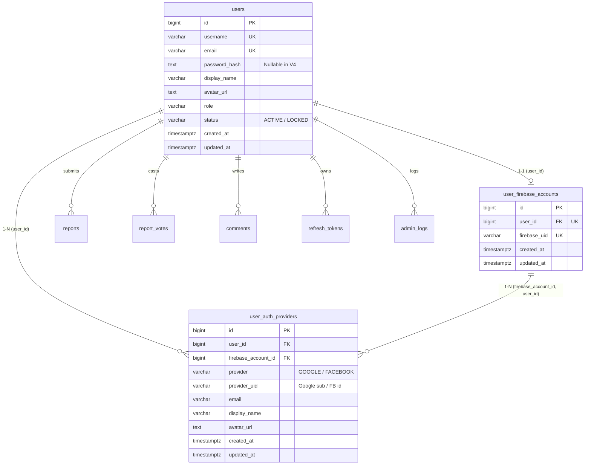

# Bàn giao kỹ thuật CityGuard Database V4 cho Backend (TV5) & Team Lead (TV1)

## 1. Mục tiêu và phạm vi phiên bản V4

CityGuard V4 bổ sung kiến trúc hỗ trợ đăng nhập mạng xã hội (Google, Facebook) thông qua Firebase Authentication:
- **Bảo toàn 100% định danh nội bộ**: Giữ nguyên `public.users.id BIGINT GENERATED ALWAYS AS IDENTITY` làm khóa chính và nguồn chân lý duy nhất (Single Source of Truth).
- **Không thay đổi các quan hệ cốt lõi**: Toàn bộ quan hệ của `reports`, `report_votes`, `comments`, `admin_logs`, `refresh_tokens` và `report_metrics` được giữ nguyên vẹn.
- **Mô hình hai bảng chuyên biệt**:
  - `user_firebase_accounts`: Ánh xạ 1-1 giữa người dùng CityGuard và tài khoản Firebase Project (`firebase_uid`).
  - `user_auth_providers`: Lưu trữ các danh tính mạng xã hội cụ thể (`GOOGLE`, `FACEBOOK`) cùng định danh của nhà cung cấp (`provider_uid`).
- **Chống ánh xạ chéo (Cross-Mapping Prevention)**: Sử dụng **Khóa ngoại ghép (Composite Foreign Key)** ở cấp độ CSDL để ngăn chặn tuyệt đối lỗi logic từ Backend gán nhầm Firebase Account của người này với Provider của người khác.
- **Hỗ trợ người dùng OAuth thuần túy**: Cho phép `users.password_hash` mang giá trị `NULL`.

---

## 2. Sơ đồ thực thể CSDL V4 (ERD)



---

## 3. Đặc tả kỹ thuật các bảng V4

### 3.1. Bảng `public.user_firebase_accounts`
| Cột | Kiểu | Ràng buộc | Mô tả |
|---|---|---|---|
| `id` | `BIGINT` | `GENERATED ALWAYS AS IDENTITY PK` | Khóa chính tự tăng |
| `user_id` | `BIGINT` | `NOT NULL`, `REFERENCES users(id) ON DELETE RESTRICT`, `UNIQUE` | Quan hệ 1-1 với `users` |
| `firebase_uid` | `VARCHAR(128)` | `NOT NULL`, `UNIQUE`, `CHECK (btrim(firebase_uid) <> '')` | Firebase UID (`sub` trong Firebase ID Token) |
| `created_at` | `TIMESTAMPTZ` | `NOT NULL DEFAULT now()` | Thời điểm liên kết Firebase |
| `updated_at` | `TIMESTAMPTZ` | `NOT NULL DEFAULT now()` | Trigger `set_updated_at()` |
| *(Composite Key)* | `(id, user_id)` | `UNIQUE` | Phục vụ Composite FK từ `user_auth_providers` |

### 3.2. Bảng `public.user_auth_providers`
| Cột | Kiểu | Ràng buộc | Mô tả |
|---|---|---|---|
| `id` | `BIGINT` | `GENERATED ALWAYS AS IDENTITY PK` | Khóa chính tự tăng |
| `user_id` | `BIGINT` | `NOT NULL`, `REFERENCES users(id) ON DELETE RESTRICT` | User sở hữu danh tính này |
| `firebase_account_id` | `BIGINT` | `REFERENCES user_firebase_accounts(id) ON DELETE RESTRICT` | Tài khoản Firebase liên kết (nếu có) |
| `provider` | `VARCHAR(32)` | `NOT NULL`, `CHECK (provider IN ('GOOGLE', 'FACEBOOK'))` | Kênh đăng nhập |
| `provider_uid` | `VARCHAR(128)` | `NOT NULL`, `CHECK (btrim(provider_uid) <> '')` | ID bên thứ 3 (Google Subject / Facebook ID) |
| `email` | `VARCHAR(254)` | `CHECK (RFC regex nếu không null)` | Email được nhà cung cấp cung cấp |
| `display_name` | `VARCHAR(100)` | Tùy chọn | Tên người dùng phía nhà cung cấp |
| `avatar_url` | `TEXT` | Tùy chọn | Đường dẫn ảnh đại diện bên thứ 3 |
| `created_at` | `TIMESTAMPTZ` | `NOT NULL DEFAULT now()` | Thời điểm tạo |
| `updated_at` | `TIMESTAMPTZ` | `NOT NULL DEFAULT now()` | Trigger `set_updated_at()` |

#### Các ràng buộc duy nhất & khóa ngoại ghép trọng yếu:
- `CONSTRAINT uq_user_auth_provider_identity UNIQUE (provider, provider_uid)`: Ngăn chặn 1 tài khoản Google/Facebook bị gắn vào 2 user CityGuard khác nhau.
- `CONSTRAINT uq_user_auth_provider_per_user UNIQUE (user_id, provider)`: Ngăn chặn 1 user gắn 2 tài khoản cùng loại (ví dụ: 1 user không thể link 2 nick Google).
- `CONSTRAINT user_auth_providers_composite_user_firebase_fkey FOREIGN KEY (firebase_account_id, user_id) REFERENCES public.user_firebase_accounts(id, user_id) ON DELETE RESTRICT`: **Bảo vệ toàn vẹn tuyệt đối**, chặn mọi lỗi logic phía Backend gán nhầm `firebase_account_id` của User A với `user_id` của User B.

---

## 4. Luồng xử lý dữ liệu và Quy tắc nghiệp vụ cho Backend (TV5)

### 4.1. Luồng xác thực Firebase ID Token (Đăng nhập / Đăng ký)
Client (Android) gửi `idToken` (chuỗi JWT của Firebase) lên endpoint Backend (ví dụ `POST /api/v1/auth/firebase-login`).

```
1. Backend verify idToken với Firebase Admin SDK
   ├── Lấy firebase_uid = decodedToken.getUid()
   ├── Lấy providerId = decodedToken.getSignInProvider() ('google.com' hoặc 'facebook.com')
   └── Lấy provider_uid = decodedToken.getClaims() -> identities[providerId][0]
2. Tra cứu user_firebase_accounts theo firebase_uid
   ├── [TRƯỜNG HỢP A: ĐÃ TỒN TẠI]
   │   ├── Lấy user_id từ user_firebase_accounts
   │   ├── Tra cứu bảng users theo user_id
   │   ├── Kiểm tra users.status:
   │   │   ├── Nếu 'LOCKED': Ném lỗi HTTP 403 FORBIDDEN (Tài khoản bị khóa)
   │   │   └── Nếu 'ACTIVE': Cấp cặp token CityGuard (Access Token + Refresh Token)
   │   └── Đảm bảo bản ghi trong user_auth_providers đã được cập nhật/tạo mới nếu vừa link thêm provider
   │
   └── [TRƯỜNG HỢP B: CHƯA TỒN TẠI]
       ├── Kiểm tra email từ token:
       │   ├── [B.1: Email đã tồn tại trong bảng users]
       │   │   └── NGUY CƠ ACCOUNT TAKEOVER: TUYỆT ĐỐI KHÔNG TỰ ĐỘNG LINK.
       │   │       Yêu cầu user đăng nhập mật khẩu cũ (hoặc xác thực OTP) rồi gọi API "Link Social Account".
       │   └── [B.2: Email chưa tồn tại trong bảng users]
       │       └── TẠO TÀI KHOẢN SOCIAL MỚI:
       │           ├── 1. Sinh username ngẫu nhiên (nếu email null hoặc client không truyền username)
       │           ├── 2. INSERT INTO users (username, email, password_hash=NULL, display_name, avatar_url, role='USER', status='ACTIVE')
       │           ├── 3. INSERT INTO user_firebase_accounts (user_id, firebase_uid)
       │           ├── 4. INSERT INTO user_auth_providers (user_id, firebase_account_id, provider, provider_uid, email, display_name, avatar_url)
       │           └── 5. Cấp cặp token CityGuard (Access Token + Refresh Token)
```

### 4.2. Quy tắc xử lý Email trùng tài khoản Local (Chống Account Takeover)
- Kẻ tấn công có thể tạo tài khoản Facebook/Google với email giả mạo hoặc chưa qua verify.
- **Nguyên tắc**: Nếu `users.email` đã tồn tại, Backend **chặn đăng nhập ngay lập tức** và trả về mã lỗi thích hợp (ví dụ: `409 CONFLICT` kèm thông điệp: *"Email này đã được đăng ký bằng mật khẩu. Vui lòng đăng nhập bằng tài khoản mật khẩu và thực hiện liên kết mạng xã hội trong phần cài đặt"*).

### 4.3. Quy tắc tài khoản bị khóa (`users.status = 'LOCKED'`)
- Trạng thái khóa tài khoản được kiểm soát tập trung tại `users.status`.
- Dù Firebase xác thực thành công, Backend luôn phải kiểm tra `users.status`. Nếu là `LOCKED`, từ chối cấp phát token và trả về HTTP `403 FORBIDDEN`.

### 4.4. Quy tắc `users.password_hash = NULL`
- Người dùng tạo tài khoản qua Google/Facebook có `password_hash = NULL`.
- Khi người dùng này vô tình gọi API đăng nhập truyền thống `POST /api/v1/auth/login`:
  - `user.getPasswordHash()` trả về `null`.
  - Backend phải kiểm tra `if (user.getPasswordHash() == null)` và trả về HTTP 401 Unauthorized (`"Tài khoản hoặc mật khẩu không chính xác"`), không để lọt vào encoder gây ngoại lệ.
- Nếu người dùng muốn bổ sung mật khẩu sau này, Backend cung cấp API `POST /api/v1/auth/set-password` (chỉ cho phép khi `password_hash IS NULL`).

---

## 5. Danh sách các file Backend TV5 cần chỉnh sửa & bổ sung

### 5.1. Các file cần chỉnh sửa hiện có

1. **`User.java` (`com.cityguard.backend.entity.User`)**:
   - Dòng 36: Bỏ `nullable = false` trên trường `passwordHash`.
   ```java
   @Column(name = "password_hash", columnDefinition = "text")
   private String passwordHash;
   ```

2. **`AuthServiceImpl.java` (`com.cityguard.backend.service.impl.AuthServiceImpl`)**:
   - Trong phương thức `login(LoginRequest request)` (Dòng 89):
   ```java
   if (user.getPasswordHash() == null || !passwordEncoder.matches(request.getPassword(), user.getPasswordHash())) {
       throw new AppException(ErrorCode.UNAUTHORIZED, "Tài khoản hoặc mật khẩu không chính xác");
   }
   ```

### 5.2. Các Entity và Repository mới cần tạo

1. **`UserFirebaseAccount.java`**:
   - Khớp với bảng `user_firebase_accounts` (`id`, `user`, `firebaseUid`, `createdAt`, `updatedAt`).
2. **`UserAuthProvider.java`**:
   - Khớp với bảng `user_auth_providers` (`id`, `user`, `firebaseAccount`, `provider`, `providerUid`, `email`, `displayName`, `avatarUrl`, `createdAt`, `updatedAt`).
3. **`UserFirebaseAccountRepository.java`**:
   - `Optional<UserFirebaseAccount> findByFirebaseUid(String firebaseUid);`
   - `Optional<UserFirebaseAccount> findByUserId(Long userId);`
4. **`UserAuthProviderRepository.java`**:
   - `Optional<UserAuthProvider> findByProviderAndProviderUid(String provider, String providerUid);`
   - `List<UserAuthProvider> findByUserId(Long userId);`
   - `boolean existsByProviderAndProviderUid(String provider, String providerUid);`

### 5.3. Các test TV5 cần bổ sung

1. **Unit Test `AuthServiceImplTest`**:
   - Test đăng nhập truyền thống với user có `passwordHash == null` $\rightarrow$ Ném `UNAUTHORIZED`.
   - Test đăng ký tài khoản mới qua Firebase $\rightarrow$ Tạo đủ bản ghi trên `users`, `user_firebase_accounts`, `user_auth_providers`.
   - Test đăng nhập Firebase khi `users.status == 'LOCKED'` $\rightarrow$ Ném `FORBIDDEN`.
2. **Integration Test `FirebaseAuthIntegrationTest`**:
   - Mock Firebase Admin SDK (`FirebaseToken`).
   - Test liên kết tài khoản Google sau đó liên kết tiếp Facebook $\rightarrow$ Kiểm tra đủ 2 provider cho 1 user.
   - Test trùng `provider_uid` $\rightarrow$ Ném `CONFLICT` (HTTP 409).
