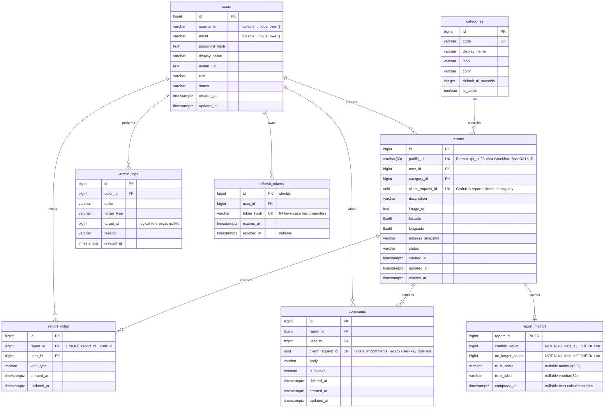

# CityGuard V3 ERD (baseline V1 + migration V2 + migration V3)

### Điểm nhấn cấu trúc V3:

1. **`reports.id` (BIGINT PK) được bảo toàn nguyên vẹn**:
   - Tất cả FK nội bộ (`report_votes.report_id`, `comments.report_id`, `report_metrics.report_id`) tiếp tục tham chiếu `reports.id`.
   - Hiệu năng JOIN và index foreign key không thay đổi.

2. **`reports.public_id` (VARCHAR(30) UK NOT NULL)**:
   - Định dạng: tiền tố `rpt_` (4 ký tự thường) kết hợp với chuỗi 26 ký tự ULID canonical chữ hoa chuẩn Crockford Base32 (`0-9`, `A-Z` loại trừ `I, L, O, U`, ký tự đầu thuộc `0-7`).
   - Ràng buộc: `CHECK (public_id ~ '^rpt_[0-7][0-9A-HJKMNP-TV-Z]{25}$')` và `UNIQUE (public_id)`.
   - Dùng làm định danh công khai cho API, định tuyến URL và hiển thị ứng dụng Android/Web (`GET /api/v1/reports/{public_id}`).

3. **`reports.client_request_id` (UUID UK NOT NULL)**:
   - Giữ nguyên toàn bộ cơ chế chống gửi trùng (idempotency key) toàn bảng đã được thiết lập ở V2.

4. **8 bảng cốt lõi**:
   - Vẫn gồm 8 bảng: `users`, `categories`, `reports`, `report_votes`, `comments`, `admin_logs`, `report_metrics`, `refresh_tokens`.
